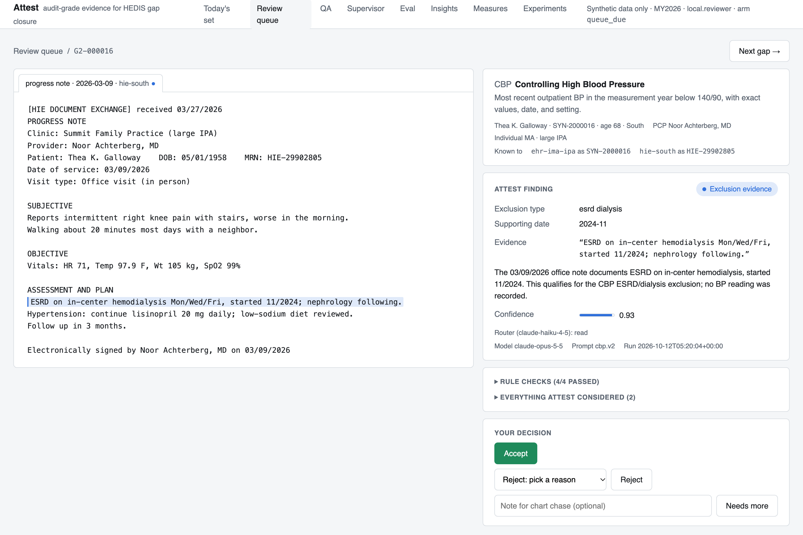
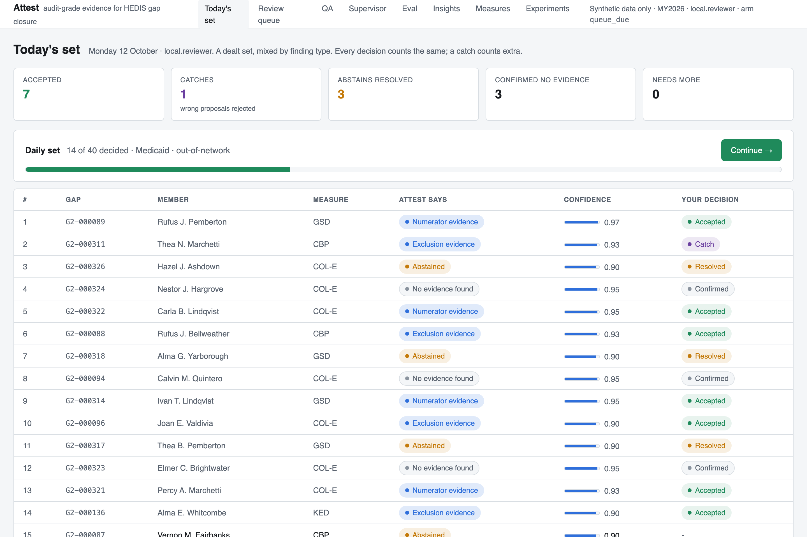
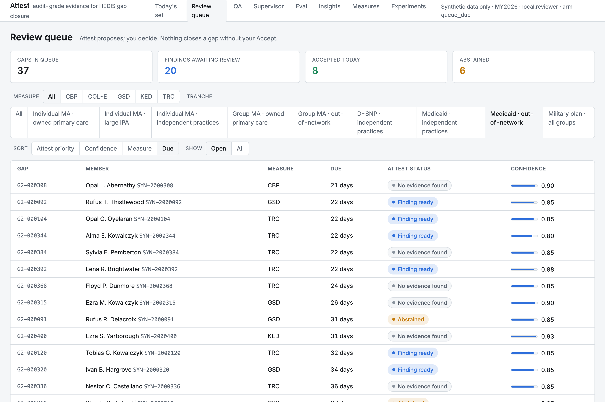
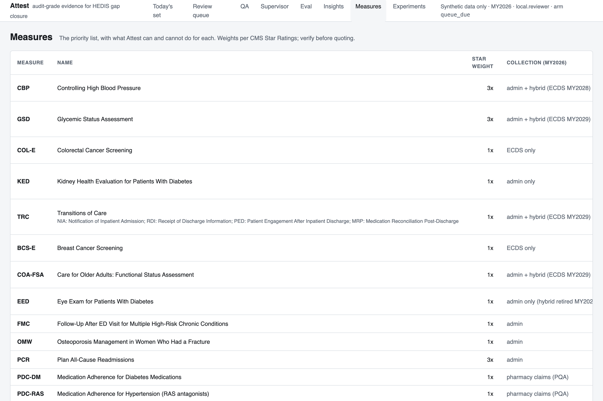
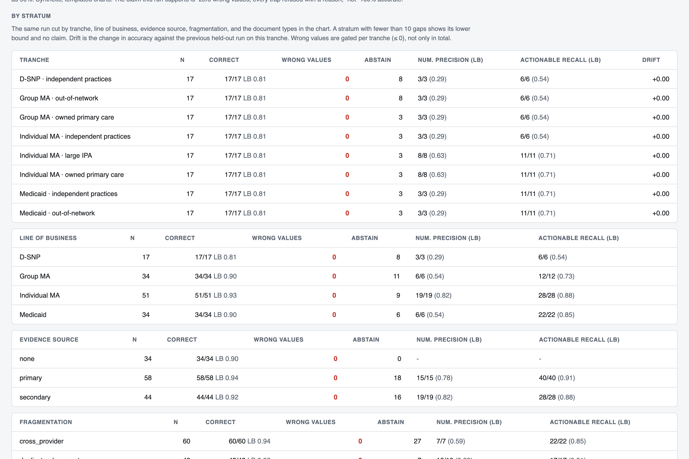
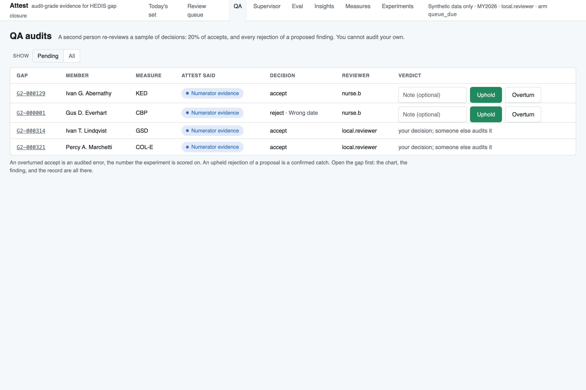
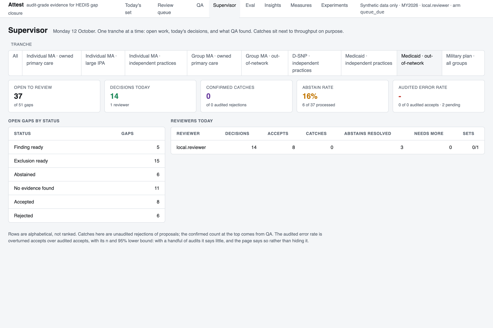
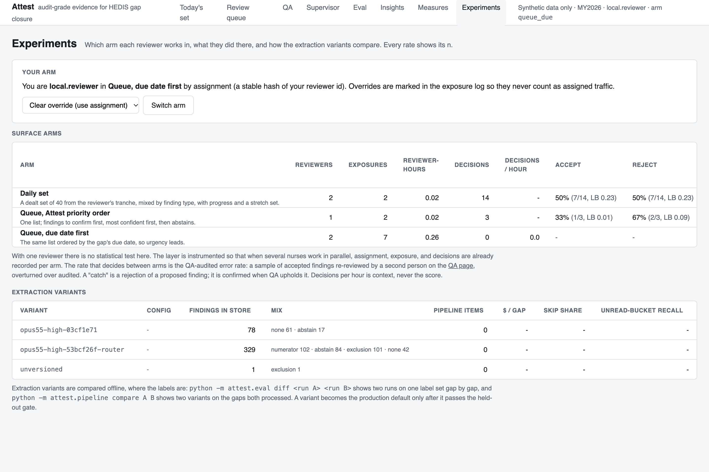

# Attest

**Audit-grade evidence for HEDIS gap closure.** A model reads unstructured clinical documents, finds evidence that an open care gap is already closed, quotes it verbatim, and hands a structured finding to a quality nurse. The nurse decides. The AI never closes a gap on its own.

**Every record in this repository is synthetic.** The members, providers, charts, lab reports, and faxes were generated by [scripts/generate_data_v2.py](scripts/generate_data_v2.py) from templates; there is no PHI, no real member, provider, or claims data, and nothing derived from any health plan's systems anywhere in the project. HEDIS measure definitions are public specifications (NCQA).

Built by Phil Rajewski as a working prototype of a pattern: documents in many shapes, a model that extracts and checks against rules, an incomplete case that names its own gap instead of guessing, and a person who makes the regulated call.

## The problem

A HEDIS care gap is a member who is due for a measure with no qualifying evidence in the plan's data. Often the care happened. A blood pressure reading sits in a progress note, a colonoscopy from four years ago in a history line, an A1c on a faxed lab report from a clinic that isn't in the plan's EHR feed. None of that reaches the gap engine, which sees claims and structured feeds. Today a quality nurse finds it by reading charts one at a time, at roughly four gaps an hour.

The hard parts are not the reading. They are the rules (a BP reading in the emergency department doesn't count; a "normal" colonoscopy with no date doesn't count; a hospice enrollment is an exclusion, never a numerator hit), the fragmentation (the same member is known by different identifiers in the EHR, the health information exchange, and the fax), and the audit (NCQA requires a person to make the final determination on anything taken from unstructured text, and the determination has to be traceable to a source span). A system that is right 97% of the time and silently wrong the other 3% is worse than no system, because a nurse under throughput pressure will accept the wrong value.

## What it does



For each open gap, Attest reads the member's chart (every document, from every source) with one model call constrained to a JSON schema, then runs deterministic checks on whatever the model proposes: the quote appears verbatim in the cited document, the extracted numbers appear in the quote, the date is exact and inside the window, the threshold holds, the setting is eligible. A proposal that fails a check never reaches the queue as a finding. A chart with no usable evidence produces an abstain with a reason code, which is a first-class outcome, not an error.

The nurse sees the document with the evidence highlighted next to the finding, and accepts, rejects with a reason, or asks for more. Accept writes the record: the values, the source document and character span, the model and prompt version, the extraction variant, the reviewer, the surface they worked in, and a timestamp. That record is the submittable output. There is no code path that marks a gap closed.

```
chart documents ──► find_evidence ──► model (structured JSON) ──► check_rules ──► finding in the queue
                                                                                      │
                                                     nurse: Accept / Reject / Needs more
                                                                                      │
                                                         record_decision ──► audit-grade record
```

Five measures are active on charts: CBP (controlling high blood pressure), GSD (glycemic status assessment), COL-E (colorectal cancer screening), TRC (transitions of care, four indicators), and KED (kidney health evaluation), plus their exclusions. A registry describes 14 measures as data, including four that have no chart lever at all, so the product says which measures it does not help with.

## Where the AI decides, recommends, and hands off

| | What | Where it is true in the code |
|---|---|---|
| **Decides** | The order in which the queue is worked: findings to confirm first, then abstains a person must resolve, then charts where nothing was found | `PRIORITY` and the default sort in [attest/app.py](attest/app.py) |
| | Which chase targets to rank highest on the Insights page | `insight_data()` in [attest/app.py](attest/app.py): a rule-based score shown with its components |
| **Recommends** | Every finding. A finding is a proposal with its evidence attached: type, extracted fields, verbatim quotes with character spans, confidence, rationale, and what the model considered and rejected | [attest/extractor.py](attest/extractor.py), [attest/schema.py](attest/schema.py) |
| **Hands off** | The final determination on every finding | Only `service.record_decision(..., "accept", reviewer)` creates a record, and it requires a person |
| | Anything abstained, or with conflicting readings or an ambiguous date or setting | The prompts tell the model to abstain with a reason. Accept is disabled in the UI and refused by the service (`NothingToAccept`) |
| | Any finding that fails a rule check | [attest/rules.py](attest/rules.py) downgrades it to abstain (or none) and records the failed check |
| | Any chart the model declines to read | Retried once, then a named fallback model that signs its own name on the record, then an abstain to the nurse (`model_refused`). Nothing is dropped silently |
| | Record submission | Attest writes records; it does not submit them |

Two product rules hold across versions, surfaces, and experiments:

1. **v2 reads v1; v1 reads nothing from v2.** A newer version imports and keeps the older version's findings and records under their `schema_version`. Backward compatibility is one-directional by design.
2. **Score correct decisions, not volume.** Anything that counts reviewer work counts a resolved abstain and a justified reject the same as an accept, samples accepted findings for a second person's audit, and treats a catch (rejecting a wrong proposal) as the best outcome. There is no throughput leaderboard. Throughput pressure is how a nurse accepts a wrong value, which is the failure Attest exists to prevent.

## The evaluation

This is the part that separates the project from a demo, so it gets the most space.

**The golden set.** 136 held-out gaps across five measures and eight provider-group tranches, drawn from a synthetic population of 100,000 gaps, 93,719 members, and 85,632 documents (48% from non-EHR sources). Every held-out label was reviewed by hand, in three passes (96, then 7 regenerated after a generator defect, then 40 new for TRC and KED), before any prompt work on that measure, and the set is never tuned against. A separate dev split is the only data used for prompt work. The charts are built to be hard on purpose: duplicates, cross-provider notes, evidence that lives only in a secondary source under a different identifier, and 34 traps (ranges instead of readings, emergency-department settings, non-digital home readings, vague or out-of-window dates, tests ordered but not done, superseded readings, exclusions that look like numerator hits).

**The bar.** Zero wrong values. A wrong extracted value that a nurse might accept is the failure an auditor punishes, so precision is gated and recall is not: refusing is allowed, being wrong is not.

**The run of record** (`20261012T172436Z-v2-heldout`, printed by `make eval-report` with no API key):

| Metric | Result | n | 95% lower bound |
|---|---|---|---|
| Gaps correct | 136/136 | 136 | 0.97 |
| Wrong values | 0 | 136 | |
| Field accuracy (exact value and date) | 68/68 | 68 | 0.95 |
| Traps refused, with the correct reason | 34/34 | 34 | 0.90 |
| Per tranche, accuracy | 17/17 in each of 8 | 17 | 0.81 |
| Per line of business, accuracy | 51/51, 34/34, 34/34, 17/17 | 51 to 17 | 0.93 to 0.81 |
| Per measure, TRC and KED | 8/8 each | 8 | 0.63 |
| Evidence found only in a secondary source (HIE or fax) | 44/44 | 44 | 0.92 |
| Calls served by the fallback model | 4/136, all correct | 4 | |

**How to read it.** Every rate on every page of the app shows n and an exact 95% lower bound, because 34 of 34 sounds like certainty and is consistent with a true rate as low as 90%. Strata under 10 gaps show a bound and never a rate. TRC and KED are eight held-out gaps per indicator, which is enough to show the pipeline works and not enough to quote a rate. The defensible claim is "zero wrong values and every trap refused with a reason, on templated synthetic charts," not "100% accurate."

**What the harness caught.** Four defects in the project's own synthetic data were found by the model refusing to accept them, and each is in [docs/CHANGELOG.md](docs/CHANGELOG.md) with its fix:

- Twice, a note said the member enrolled in hospice on a date after the note itself. The generator had drawn the hospice date independently of the visit date. The model abstained on an internally inconsistent document rather than apply the exclusion. The labels were wrong; the model was right.
- An "outreach-only" trap for transitions of care was itself an office visit two weeks after discharge, which is patient engagement. The model called it engagement.
- A prior-year lab date was caught before any model run, by replaying every labeled finding through the deterministic rule checks as if the model had produced it.
- The first router prompts never ran at all (a parameter the small model rejects, hidden by a fail-open path), and the first cost comparison priced the small model at the large model's rate because served-model ids carry a date suffix the price table didn't match. Both found by measuring.

**The gate.** Every push to `main` runs the held-out set against the live model before deploying (about $3 a run). Numerator precision may not drop at all; zero wrong values overall and in every tranche. The deploy does not happen if it fails.

**Honest about what it can't say yet.** No winner between review surfaces, because one reviewer can't produce a comparison. The router variant is not a cost win on this population. Synthetic identity links are clean by construction; real matching is probabilistic, and the pipeline is shaped to carry a match confidence rather than produce one.

## Scale, measured

The batch pipeline ([attest/pipeline.py](attest/pipeline.py)) runs extraction over a population with idempotent jobs keyed on (gap, variant), so a rerun continues where it stopped and two variants can be compared on the same gaps. On 1,088 gaps across all eight tranches at 4 workers, with the per-measure system prompt as an explicit cache breakpoint: **$0.0119 per gap** at an 83% cache-hit share, against $0.0235 uncached. One pass over a million gaps is about $12,000. Output tokens are two-thirds of the cost. Eight workers hit rate limiting and ran three times slower than four.

A router variant (a cheap first pass that decides whether a chart has anything worth reading) was measured on 1,000 common gaps and not shipped as a win: it skipped 23% of charts, lost zero closures, and saved 3%, because its own calls never cache and the charts it skips are the cheap ones. The guardrail that made the measurement possible stays: skipped charts are a bucket, QA-sampled with the full extractor, with recall on that bucket reported per tranche. Without it, routing is a silent recall cut.

## The review surfaces, and how they'll be compared



Three surfaces, assigned to reviewers by a stable hash of their id: the queue in priority order, the queue in due-date order, and the daily set, 40 gaps dealt from one tranche, stratified by finding type so no run of forty accepts trains the wrong reflex, with an optional stretch set of 10. Leases mean two nurses never work the same gap and a second Accept is impossible.

The experiment is scored on the **audited error rate**: a 20% sample of accepts and every rejection of a proposed finding go to a second person, nobody audits their own, and overturned accepts over audited accepts is the number, shown per arm and per tranche with n and a lower bound. An upheld rejection is a confirmed catch, and the supervisor view puts confirmed catches as a headline next to throughput. Decisions per hour is context, and the page leaves it blank until an arm has 15 reviewer-minutes.

Every finding carries the extraction variant that produced it (model, effort, prompt versions, router); every decision carries the variant and the surface arm. Extraction variants are compared offline where the labels are (`python -m attest.eval diff`, `python -m attest.pipeline compare`), and a variant becomes the default only after it passes the held-out gate.

## Screenshots

All on synthetic data, measurement year 2026. The full set with captions is in [docs/screenshots/2026-10-12](docs/screenshots/2026-10-12).

| | |
|---|---|
|  Queue, filtered to one business unit |  The measure registry |
|  Eval by stratum |  QA |
|  Supervisor |  Experiments |

## Running it

```bash
make dev             # app + Postgres in Docker on http://localhost:8080 (needs only Docker)
make eval-report     # print the held-out eval of record; no API key, no spend
```

On first start the container imports the dataset and the committed findings snapshot, so the queue is populated with no API call. An `ANTHROPIC_API_KEY` in `.env` is needed only for live extraction and evals (`make eval` reruns the dev split, about $1; `make eval-heldout` the held-out set, about $2). Without Docker: `make venv`, then `make run` (SQLite), `make test`, `make lint`. Scripted test paths for every operation, including two-reviewer QA and the lease, are in [docs/test-walkthroughs-v2.md](docs/test-walkthroughs-v2.md).

---

## Reference

The sections below are for a reader who cloned it.

### How a finding is made

1. **Extraction.** One Claude API call per gap (`claude-opus-5-5`, effort high), with every document in the member's chart. One prompt per measure family, versioned by filename in [attest/prompts/](attest/prompts/); a prompt that has been run is never edited in place. Output is constrained to a JSON schema. The documentation rules are in the prompts: ranges and "BP under control" are not evidence; ED, inpatient, and day-of-procedure readings are ineligible; home readings count only from a digital device; undated results are not evidence; the most recent reading governs; exclusions are tagged as exclusions.
2. **Rule checks.** The model reads; code enforces the measure. The quote appears verbatim in the cited document (whitespace-tolerant), which yields the character span; the extracted numbers appear in the quote; dates are exact where required, inside the window, and not after the document; thresholds, settings, and sources are re-checked; exclusion types are valid for the measure. A failure downgrades the finding with the failed check shown to the reviewer.
3. **Refusals.** A model refusal is retried once, then routed to a named fallback model (`claude-opus-4-8`) that signs the record, then handed to the nurse as a `model_refused` abstain. API errors become `model_error` abstains the same way. The first TRC prompt tripped a safety classifier on a quarter of charts by asking for narrated date arithmetic; asking for conclusions took it to zero.
4. **Logging.** Every model call is logged: model requested and served, prompt version, input document ids, output, latency, tokens, request id, and each attempt's stop reason.
5. **Leases.** Opening a gap takes a 15-minute lease; anyone else sees it read-only with the holder's name. A decision releases the lease. A gap with a record takes no further decisions.

### The measure registry

[attest/measures/*.yaml](attest/measures/) holds all 14 measures as data: name, Star weight, collection method, chart lever (strong, supplemental, small, none), status, and for the active ones the rule family, fields, windows, thresholds, exclusions, and prompt version. A measure with indicators (TRC has four) carries one spec per indicator. Rule families: `blood_pressure`, `lab_value`, `paired_labs`, `procedure_window`, `event_window`, plus the shared exclusion checks. Adding a measure is a YAML file, a prompt version, and synthetic traps with hand-reviewed labels, not new rule code.

### Tranches and stratified eval

The population is organized as a two-level hierarchy: line of business (Individual MA, Group MA, D-SNP, Medicaid) and provider group (owned primary care, large IPA, independent practices, out of network). The source profile follows the group: an owned group has an EHR feed, an independent practice has fax. Region is a member attribute, not a tranche. A fifth line of business (Military) is present with members and no gaps, with the reason shown, so the exclusion is visible rather than silent. Documents carry their source and the source's own member identifier; an identity table links them, and the review page shows every identity the member is known by.

Every eval run is scored per stratum: tranche, line of business, measure, evidence source, fragmentation kind, and document types. Each stratum shows n, correct, wrong values, abstains, precision and recall with lower bounds. A stratum under 10 gaps is flagged and shows its bound only. The CI gate fails on a wrong value in any tranche, not only on the total.

### The service seam

[attest/service.py](attest/service.py) is the boundary between the core and its surfaces:

| Function | Does |
|---|---|
| `find_evidence(gap_id)` | Reads the gap's chart with the model and returns a checked finding: numerator, exclusion, abstain with a reason, or none |
| `check_rules(gap_id, finding)` | Runs the deterministic checks and returns the finding with pass/fail per check |
| `claim(gap_id, reviewer)` | Takes or renews the reviewer's lease; raises `Locked` if someone else holds it |
| `record_decision(gap_id, action, reviewer, reason=None, note=None)` | Records a person's decision. On `accept` of a verified finding, writes the structured record. Raises `Locked` or `AlreadyDecided` |

The web app is one surface on this service. The same three functions are the shape of an MCP tool or a skill for ad hoc use (an auditor checking one chart). The record write stays in the service, so a decision from any surface carries the same signatures. Routes: `GET /queue`, `GET /gap/{id}`, `POST /gap/{id}/decision`, `GET /records.json`, `GET /eval`, `GET /insights`, `GET /measures`, `GET /experiments`, `GET /today`, `GET /qa`, `GET /supervise`, `POST /admin/reset`, `GET /health`.

### Storage

[attest/store.py](attest/store.py) is SQLAlchemy Core over Postgres (`make dev`) or SQLite (tests and quick local runs); `DATABASE_URL` picks the backend and the whole test suite runs on both. The dataset lives in the store (tranches, providers, members, identities, gaps, documents), imported from a bundle. Every finding, decision, and record carries a `schema_version`; v1 state imports with `python -m attest.seed import-v1`.

### CI

[.github/workflows/ci.yml](.github/workflows/ci.yml): on every push and pull request, lint and the unit tests on SQLite and Postgres, with no model calls. On `main`, additionally the eval gate against the live model when an `ANTHROPIC_API_KEY` secret is configured. The gate fails the build if numerator precision drops below 1.0 or any wrong value appears, overall or in any tranche. Recall and abstain rate are reported, not gated.

### What changes for production

| Prototype | Production |
|---|---|
| Postgres, one container | Managed Postgres with an append-only audit log, partitioning by tranche |
| Shared demo password | SSO with roles (abstractor, QA lead, auditor) |
| Synthetic text charts, clean identity links | EHR and HIE feeds, FHIR `DocumentReference`, faxed records with OCR, probabilistic identity matching with a confidence the record carries; PHI controls, BAA, retention |
| Records exported as JSON | Records flow to the hybrid review and supplemental-data pipelines with auditable lineage |
| Findings pre-computed from a snapshot | Event-driven extraction as charts arrive; re-extraction when a prompt or model version changes |
| 136-gap held-out set | Larger labeled sets drawn from real abstraction work, stratified by measure, provider, and document type; drift monitoring |

### Roadmap

- More measures as YAML: BCS-E and EED next (prior care found in history lines), then COA functional status and OMW, each with synthetic traps and labels before any prompt work.
- The arm comparison, once several reviewers are on it.
- The service as an MCP tool for ad hoc chart checks.
- Hosted inference and batch evals on Modal, with a spend cap from the first commit.

### Repo layout

```
attest/            service, extractor, rule checks, measures/, pipeline, experiments, daily set, eval, web app (FastAPI + Jinja), prompts/
data/              synthetic population bundles and labels (dev / held-out)
seed/              committed findings snapshot loaded at startup
evals/             eval runs and history
scripts/           synthetic data generators
docs/              changelog, style note, test walkthroughs, screenshots
tests/             unit tests (rules, service, app, eval gate, data integrity)
```

MIT license.
